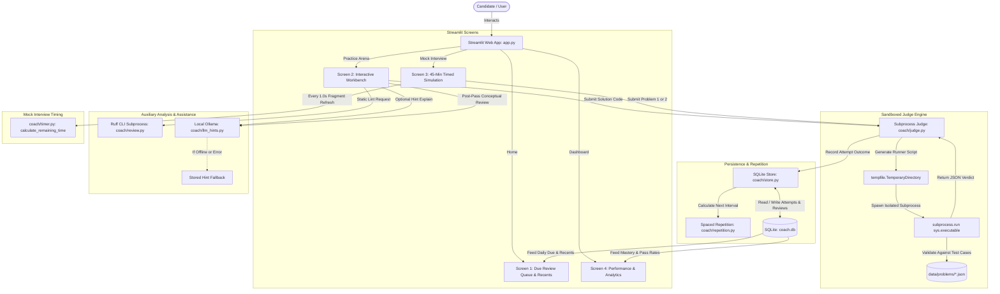

# Architecture

> Generated by /map on 2026-11-05

## Overview

AI Coding Prep Coach is a zero-cost, privacy-first, local coding interview preparation application built with Python 3.12 and Streamlit 1.66.1 ([`PRODUCT.md:9`](file:///C:/Users/MS%20Computer/.gemini/antigravity/worktrees/a88a339d-8602-40c1-9fa8-9253ebf3f144/subagent-Codebase-Mapper-gsd-researcher-45289546/PRODUCT.md#L9), [`requirements.txt:2`](file:///C:/Users/MS%20Computer/.gemini/antigravity/worktrees/a88a339d-8602-40c1-9fa8-9253ebf3f144/requirements.txt#L2)).

The central architectural tenet of the platform is: **"The judge is code, not AI"** ([`PRODUCT.md:40`](file:///C:/Users/MS%20Computer/.gemini/antigravity/worktrees/a88a339d-8602-40c1-9fa8-9253ebf3f144/subagent-Codebase-Mapper-gsd-researcher-45289546/PRODUCT.md#L40), [`app.py:4`](file:///C:/Users/MS%20Computer/.gemini/antigravity/worktrees/a88a339d-8602-40c1-9fa8-9253ebf3f144/app.py#L4), [`specs/001-coding-prep-coach/spec.md:9`](file:///C:/Users/MS%20Computer/.gemini/antigravity/worktrees/a88a339d-8602-40c1-9fa8-9253ebf3f144/specs/001-coding-prep-coach/spec.md#L9)). Candidate code submissions are judged deterministically and objectively by running inside a stripped, timeout-enforced subprocess sandbox against hidden unit test suites ([`coach/judge.py:102-136`](file:///C:/Users/MS%20Computer/.gemini/antigravity/worktrees/a88a339d-8602-40c1-9fa8-9253ebf3f144/coach/judge.py#L102-L136)). An optional local LLM integration via Ollama (`qwen2.5-coder:3b`) provides progressive hint explanations and conceptual post-pass code reviews, but never scores code, never creates tests, and degrades to stored hints when offline ([`coach/llm_hints.py:22-43`](file:///C:/Users/MS%20Computer/.gemini/antigravity/worktrees/a88a339d-8602-40c1-9fa8-9253ebf3f144/coach/llm_hints.py#L22-L43), [`CONTRACT.md:129`](file:///C:/Users/MS%20Computer/.gemini/antigravity/worktrees/a88a339d-8602-40c1-9fa8-9253ebf3f144/CONTRACT.md#L129)).

Practice history and review schedules are persisted locally in SQLite (`coach.db`), governed by a deterministic spaced repetition algorithm (1, 1, 3, 7, 21 days) ([`coach/repetition.py:22-37`](file:///C:/Users/MS%20Computer/.gemini/antigravity/worktrees/a88a339d-8602-40c1-9fa8-9253ebf3f144/coach/repetition.py#L22-L37), [`coach/store.py:25-49`](file:///C:/Users/MS%20Computer/.gemini/antigravity/worktrees/a88a339d-8602-40c1-9fa8-9253ebf3f144/coach/store.py#L25-L49)).

---

## System Diagram

---

## Components

### 1. Web Application & Navigation Controller (`app.py`)
- **Purpose:** Central Streamlit entrypoint controlling navigation, theme styling, state management, and page rendering across four dedicated screens ([`app.py:23-27`](file:///C:/Users/MS%20Computer/.gemini/antigravity/worktrees/a88a339d-8602-40c1-9fa8-9253ebf3f144/app.py#L23-L27), [`app.py:141-158`](file:///C:/Users/MS%20Computer/.gemini/antigravity/worktrees/a88a339d-8602-40c1-9fa8-9253ebf3f144/app.py#L141-L158)).
- **Location:** `app.py` (749 lines)
- **Key Modules & Handlers:**
  - `get_store()`: Cached connection to SQLite store via `@st.cache_resource` ([`app.py:75-76`](file:///C:/Users/MS%20Computer/.gemini/antigravity/worktrees/a88a339d-8602-40c1-9fa8-9253ebf3f144/app.py#L75-L76)).
  - `get_problems()`: Cached catalog loader via `@st.cache_data` calling `coach.problems.load_all_problems` ([`app.py:83-85`](file:///C:/Users/MS%20Computer/.gemini/antigravity/worktrees/a88a339d-8602-40c1-9fa8-9253ebf3f144/app.py#L83-L85)).
  - `render_editor()`: Wraps `streamlit-code-editor` with fallback to `st.text_area` ([`app.py:92-132`](file:///C:/Users/MS%20Computer/.gemini/antigravity/worktrees/a88a339d-8602-40c1-9fa8-9253ebf3f144/app.py#L92-L132)).
  - Screen 1: Home / Due Review Queue ([`app.py:169-221`](file:///C:/Users/MS%20Computer/.gemini/antigravity/worktrees/a88a339d-8602-40c1-9fa8-9253ebf3f144/app.py#L169-L221)).
  - Screen 2: Practice Arena with progressive hints, judge cards, Ruff lint, and post-pass AI review ([`app.py:226-403`](file:///C:/Users/MS%20Computer/.gemini/antigravity/worktrees/a88a339d-8602-40c1-9fa8-9253ebf3f144/app.py#L226-L403)).
  - Screen 3: Mock Interview Arena with `@st.fragment(run_every=1.0)` live countdown and Markdown scorecard download ([`app.py:407-673`](file:///C:/Users/MS%20Computer/.gemini/antigravity/worktrees/a88a339d-8602-40c1-9fa8-9253ebf3f144/app.py#L407-L673)).
  - Screen 4: Dashboard displaying current streak, review due, and Plotly topic pass rates ([`app.py:678-749`](file:///C:/Users/MS%20Computer/.gemini/antigravity/worktrees/a88a339d-8602-40c1-9fa8-9253ebf3f144/app.py#L678-L749)).
- **Dependencies:** `streamlit`, `streamlit-code-editor`, `plotly`, `coach.judge`, `coach.llm_hints`, `coach.problems`, `coach.review`, `coach.store`, `coach.timer` ([`app.py:13-20`](file:///C:/Users/MS%20Computer/.gemini/antigravity/worktrees/a88a339d-8602-40c1-9fa8-9253ebf3f144/app.py#L13-L20)).
- **Dependents:** Top-level application run directly by user or script.

### 2. Sandboxed Code Judge Engine (`coach/judge.py`)
- **Purpose:** Executes candidate Python code against visible and hidden test cases inside a strictly isolated subprocess ([`coach/judge.py:1-5`](file:///C:/Users/MS%20Computer/.gemini/antigravity/worktrees/a88a339d-8602-40c1-9fa8-9253ebf3f144/coach/judge.py#L1-L5)).
- **Location:** `coach/judge.py` (177 lines)
- **Design & Security Guarantees:**
  - 3.0-second execution timeout per run ([`coach/judge.py:112`](file:///C:/Users/MS%20Computer/.gemini/antigravity/worktrees/a88a339d-8602-40c1-9fa8-9253ebf3f144/coach/judge.py#L112), [`coach/judge.py:135`](file:///C:/Users/MS%20Computer/.gemini/antigravity/worktrees/a88a339d-8602-40c1-9fa8-9253ebf3f144/coach/judge.py#L135)).
  - Dedicated empty temporary working directory created via `tempfile.TemporaryDirectory()` ([`coach/judge.py:123-124`](file:///C:/Users/MS%20Computer/.gemini/antigravity/worktrees/a88a339d-8602-40c1-9fa8-9253ebf3f144/coach/judge.py#L123-L124)).
  - Sanitized environment stripping API keys and secrets; sets `PYTHONPATH=""` and `PYTHONNOUSERSITE="1"` ([`coach/judge.py:114-118`](file:///C:/Users/MS%20Computer/.gemini/antigravity/worktrees/a88a339d-8602-40c1-9fa8-9253ebf3f144/coach/judge.py#L114-L118)).
  - Runner generator injects user code, dynamic function lookup, and test loop with `copy.deepcopy` ([`coach/judge.py:18-99`](file:///C:/Users/MS%20Computer/.gemini/antigravity/worktrees/a88a339d-8602-40c1-9fa8-9253ebf3f144/coach/judge.py#L18-L99)).
  - Standard JSON response format returning status (`pass`, `fail`, `timeout`, `error`), counts, failed case details, and elapsed runtime in ms ([`coach/judge.py:140-176`](file:///C:/Users/MS%20Computer/.gemini/antigravity/worktrees/a88a339d-8602-40c1-9fa8-9253ebf3f144/coach/judge.py#L140-L176)).
- **Dependencies:** Python standard library only (`subprocess`, `tempfile`, `json`, `time`, `os`, `sys`, `copy`, `traceback`).
- **Dependents:** `app.py:15`, `tests/test_judge.py:3`, `tests/test_problems.py:3`.

### 3. Problem Bank & Schema Loader (`coach/problems.py` & `data/problems/*.json`)
- **Purpose:** Defines the validated Pydantic problem specification and loads all problem definitions from disk ([`coach/problems.py:1-4`](file:///C:/Users/MS%20Computer/.gemini/antigravity/worktrees/a88a339d-8602-40c1-9fa8-9253ebf3f144/coach/problems.py#L1-L4)).
- **Location:** `coach/problems.py` (61 lines), `data/problems/` (12 files)
- **Key Schemas:**
  - `TestCase`: Input args list and expected return value ([`coach/problems.py:15-17`](file:///C:/Users/MS%20Computer/.gemini/antigravity/worktrees/a88a339d-8602-40c1-9fa8-9253ebf3f144/coach/problems.py#L15-L17)).
  - `ProblemSchema`: Problem metadata (`id`, `title`, `topic`, `difficulty`, `track`), statement Markdown, entrypoint function name, starter template, tests (`visible_tests` min 2, `hidden_tests` min 5), hints (exact 3), reference solution, and timeout ([`coach/problems.py:20-34`](file:///C:/Users/MS%20Computer/.gemini/antigravity/worktrees/a88a339d-8602-40c1-9fa8-9253ebf3f144/coach/problems.py#L20-L34)).
- **Curated Problem Library (12 Problems):**
  - DSA Track (9): `two-sum`, `valid-parentheses`, `longest-substring-without-repeating`, `reverse-sequence`, `binary-search`, `max-subarray`, `tree-level-order`, `climbing-stairs`, `string-permutations`.
  - Python Practical Track (3): `csv-column-summary`, `log-timestamp-filter`, `flatten-nested-dict`.
- **Dependencies:** `pydantic` ([`coach/problems.py:12`](file:///C:/Users/MS%20Computer/.gemini/antigravity/worktrees/a88a339d-8602-40c1-9fa8-9253ebf3f144/coach/problems.py#L12)), `json`, `pathlib`.
- **Dependents:** `app.py:17`, `tests/test_problems.py:4`, `tests/test_judge.py:119`.

### 4. Deterministic Spaced Repetition Engine (`coach/repetition.py`)
- **Purpose:** Computes next review intervals and target due dates based on interview retention schedules without external ML or complex heuristics ([`coach/repetition.py:1-8`](file:///C:/Users/MS%20Computer/.gemini/antigravity/worktrees/a88a339d-8602-40c1-9fa8-9253ebf3f144/coach/repetition.py#L1-L8)).
- **Location:** `coach/repetition.py` (55 lines)
- **Repetition Rules:**
  - Non-pass (`fail`, `timeout`, `error`): resets `consecutive_passes` to 0; interval is **1 day** ([`coach/repetition.py:26-27`](file:///C:/Users/MS%20Computer/.gemini/antigravity/worktrees/a88a339d-8602-40c1-9fa8-9253ebf3f144/coach/repetition.py#L26-L27)).
  - 1st consecutive pass: interval is **3 days** ([`coach/repetition.py:30-31`](file:///C:/Users/MS%20Computer/.gemini/antigravity/worktrees/a88a339d-8602-40c1-9fa8-9253ebf3f144/coach/repetition.py#L30-L31)).
  - 2nd consecutive pass: interval is **7 days** ([`coach/repetition.py:32-33`](file:///C:/Users/MS%20Computer/.gemini/antigravity/worktrees/a88a339d-8602-40c1-9fa8-9253ebf3f144/coach/repetition.py#L32-L33)).
  - 3rd+ consecutive pass: interval is **21 days** ([`coach/repetition.py:34-35`](file:///C:/Users/MS%20Computer/.gemini/antigravity/worktrees/a88a339d-8602-40c1-9fa8-9253ebf3f144/coach/repetition.py#L34-L35)).
- **Dependencies:** Python `datetime` module ([`coach/repetition.py:12`](file:///C:/Users/MS%20Computer/.gemini/antigravity/worktrees/a88a339d-8602-40c1-9fa8-9253ebf3f144/coach/repetition.py#L12)).
- **Dependents:** `coach/store.py:12`, `tests/test_store.py:2`.

### 5. SQLite Persistence Store (`coach/store.py`)
- **Purpose:** Manages relational persistence in local SQLite database `coach.db` with zero external ORM dependencies ([`coach/store.py:1-4`](file:///C:/Users/MS%20Computer/.gemini/antigravity/worktrees/a88a339d-8602-40c1-9fa8-9253ebf3f144/coach/store.py#L1-L4)).
- **Location:** `coach/store.py` (172 lines)
- **Database Schema:**
  - `attempts`: Records each run with `id`, `problem_id`, `topic`, `status`, `runtime_ms`, `hints_used`, `mode`, `attempt_date`, and `created_at` ([`coach/store.py:28-39`](file:///C:/Users/MS%20Computer/.gemini/antigravity/worktrees/a88a339d-8602-40c1-9fa8-9253ebf3f144/coach/store.py#L28-L39)).
  - `problem_reviews`: Upserted table recording `problem_id` (PRIMARY KEY), `consecutive_passes`, `last_status`, `next_due_date`, and `last_attempt_date` ([`coach/store.py:41-48`](file:///C:/Users/MS%20Computer/.gemini/antigravity/worktrees/a88a339d-8602-40c1-9fa8-9253ebf3f144/coach/store.py#L41-L48), [`coach/store.py:88-99`](file:///C:/Users/MS%20Computer/.gemini/antigravity/worktrees/a88a339d-8602-40c1-9fa8-9253ebf3f144/coach/store.py#L88-L99)).
- **Key Operations:**
  - `record_attempt()`: Atomic transaction inserting attempt and updating review schedule ([`coach/store.py:51-101`](file:///C:/Users/MS%20Computer/.gemini/antigravity/worktrees/a88a339d-8602-40c1-9fa8-9253ebf3f144/coach/store.py#L51-L101)).
  - `due_problems()`: Filters problems where `next_due_date <= target_date` ([`coach/store.py:103-116`](file:///C:/Users/MS%20Computer/.gemini/antigravity/worktrees/a88a339d-8602-40c1-9fa8-9253ebf3f144/coach/store.py#L103-L116)).
  - `topic_stats()`: Computes total attempts, passes, and pass rate per topic ([`coach/store.py:118-141`](file:///C:/Users/MS%20Computer/.gemini/antigravity/worktrees/a88a339d-8602-40c1-9fa8-9253ebf3f144/coach/store.py#L118-L141)).
  - `current_streak()`: Calculates consecutive calendar days with at least one practice attempt leading up to today ([`coach/store.py:143-157`](file:///C:/Users/MS%20Computer/.gemini/antigravity/worktrees/a88a339d-8602-40c1-9fa8-9253ebf3f144/coach/store.py#L143-L157)).
  - `get_recent_attempts()`: Fetches most recent attempts ([`coach/store.py:159-171`](file:///C:/Users/MS%20Computer/.gemini/antigravity/worktrees/a88a339d-8602-40c1-9fa8-9253ebf3f144/coach/store.py#L159-L171)).
- **Dependencies:** Python `sqlite3`, `coach.repetition.calculate_due_date`, `datetime`.
- **Dependents:** `app.py:19`, `tests/test_store.py:3`.

### 6. Mock Interview Pure Timer (`coach/timer.py`)
- **Purpose:** Pure function library for calculating remaining mock session time, handling boundaries and clock skew ([`coach/timer.py:1-4`](file:///C:/Users/MS%20Computer/.gemini/antigravity/worktrees/a88a339d-8602-40c1-9fa8-9253ebf3f144/coach/timer.py#L1-L4)).
- **Location:** `coach/timer.py` (33 lines)
- **Key Function:** `calculate_remaining_time(start_time, duration_sec, now) -> (minutes, seconds, is_expired)` ([`coach/timer.py:9-32`](file:///C:/Users/MS%20Computer/.gemini/antigravity/worktrees/a88a339d-8602-40c1-9fa8-9253ebf3f144/coach/timer.py#L9-L32)).
- **Dependencies:** Standard library only.
- **Dependents:** `app.py:20`, `tests/test_timer.py:5`.

### 7. Static Code Review Engine (`coach/review.py`)
- **Purpose:** Executes the local Ruff linter binary on candidate code via subprocess and parses diagnostics into line/column findings ([`coach/review.py:1-4`](file:///C:/Users/MS%20Computer/.gemini/antigravity/worktrees/a88a339d-8602-40c1-9fa8-9253ebf3f144/coach/review.py#L1-L4)).
- **Location:** `coach/review.py` (91 lines)
- **Key Features:**
  - `_find_ruff_executable()` locates virtual environment or system ruff binary ([`coach/review.py:17-32`](file:///C:/Users/MS%20Computer/.gemini/antigravity/worktrees/a88a339d-8602-40c1-9fa8-9253ebf3f144/coach/review.py#L17-L32)).
  - `run_ruff_lint(code)` writes temporary script, invokes `ruff check --output-format json`, and extracts error line, column, code, and message ([`coach/review.py:34-85`](file:///C:/Users/MS%20Computer/.gemini/antigravity/worktrees/a88a339d-8602-40c1-9fa8-9253ebf3f144/coach/review.py#L34-L85)).
  - Clean error recovery when Ruff is missing or encounters exceptions ([`coach/review.py:86-90`](file:///C:/Users/MS%20Computer/.gemini/antigravity/worktrees/a88a339d-8602-40c1-9fa8-9253ebf3f144/coach/review.py#L86-L90)).
- **Dependencies:** `ruff`, `subprocess`, `tempfile`, `shutil`, `json`, `pathlib`.
- **Dependents:** `app.py:18`, `tests/test_llm_fallback.py:2`.

### 8. Local AI Hint & Review Engine (`coach/llm_hints.py`)
- **Purpose:** Zero-cost local Ollama client providing progressive hint explanations and post-pass code reviews ([`coach/llm_hints.py:1-5`](file:///C:/Users/MS%20Computer/.gemini/antigravity/worktrees/a88a339d-8602-40c1-9fa8-9253ebf3f144/coach/llm_hints.py#L1-L5)).
- **Location:** `coach/llm_hints.py` (71 lines)
- **Key Functions:**
  - `explain_hint()`: Uses Ollama model `qwen2.5-coder:3b` with a 2.0s timeout to elaborate on stored hints without spoiling solution code ([`coach/llm_hints.py:12-41`](file:///C:/Users/MS%20Computer/.gemini/antigravity/worktrees/a88a339d-8602-40c1-9fa8-9253ebf3f144/coach/llm_hints.py#L12-L41)).
  - `review_code()`: Generates 3 bullet points on time complexity, space complexity, and pythonic improvements ([`coach/llm_hints.py:46-68`](file:///C:/Users/MS%20Computer/.gemini/antigravity/worktrees/a88a339d-8602-40c1-9fa8-9253ebf3f144/coach/llm_hints.py#L46-L68)).
  - Guaranteed offline fallback: Returns stored problem hint or friendly offline banner if Ollama daemon is absent or times out ([`coach/llm_hints.py:22-24, 42-43, 51, 69-70`](file:///C:/Users/MS%20Computer/.gemini/antigravity/worktrees/a88a339d-8602-40c1-9fa8-9253ebf3f144/coach/llm_hints.py#L22-L24)).
- **Dependencies:** `ollama` Python client ([`coach/llm_hints.py:26, 54`](file:///C:/Users/MS%20Computer/.gemini/antigravity/worktrees/a88a339d-8602-40c1-9fa8-9253ebf3f144/coach/llm_hints.py#L26)).
- **Dependents:** `app.py:16`, `tests/test_llm_fallback.py:1`.

---

## Data Flow

### 1. Solution Execution & Verification Flow
1. **User Writes Code:** Candidate edits Python code in the Ace code editor component in Practice Arena or Mock Interview ([`app.py:317-319`](file:///C:/Users/MS%20Computer/.gemini/antigravity/worktrees/a88a339d-8602-40c1-9fa8-9253ebf3f144/app.py#L317-L319)).
2. **Pre-flight Check:** Unchanged starter code or blank submission is rejected before judge invocation ([`app.py:326-333`](file:///C:/Users/MS%20Computer/.gemini/antigravity/worktrees/a88a339d-8602-40c1-9fa8-9253ebf3f144/app.py#L326-L333)).
3. **Sandbox Assembly:** `coach.judge.run_solution()` creates a standalone runner script in a temporary directory containing test cases, deepcopy comparisons, and user function injection ([`coach/judge.py:18-99, 123-127`](file:///C:/Users/MS%20Computer/.gemini/antigravity/worktrees/a88a339d-8602-40c1-9fa8-9253ebf3f144/coach/judge.py#L18-L99)).
4. **Subprocess Execution:** Subprocess runs with stripped environment variables and a 3.0s timeout ([`coach/judge.py:129-136`](file:///C:/Users/MS%20Computer/.gemini/antigravity/worktrees/a88a339d-8602-40c1-9fa8-9253ebf3f144/coach/judge.py#L129-L136)).
5. **Verdict Parsing:** Results (`pass`, `fail`, `timeout`, `error`), runtime in ms, and diffs are returned as JSON ([`coach/judge.py:150-176`](file:///C:/Users/MS%20Computer/.gemini/antigravity/worktrees/a88a339d-8602-40c1-9fa8-9253ebf3f144/coach/judge.py#L150-L176)).
6. **Persistence & UI Feedback:** Outcome is persisted to SQLite store ([`app.py:351-358`](file:///C:/Users/MS%20Computer/.gemini/antigravity/worktrees/a88a339d-8602-40c1-9fa8-9253ebf3f144/app.py#L351-L358)); verdict cards render in OLED theme colors ([`app.py:360-382`](file:///C:/Users/MS%20Computer/.gemini/antigravity/worktrees/a88a339d-8602-40c1-9fa8-9253ebf3f144/app.py#L360-L382)).

### 2. Spaced Repetition Update Flow
1. **Attempt Recorded:** `CoachStore.record_attempt()` is invoked with `problem_id`, `status`, `runtime_ms`, `hints_used`, and `topic` ([`coach/store.py:51-60`](file:///C:/Users/MS%20Computer/.gemini/antigravity/worktrees/a88a339d-8602-40c1-9fa8-9253ebf3f144/coach/store.py#L51-L60)).
2. **Current Schedule Queried:** Database retrieves previous `consecutive_passes` for the problem ([`coach/store.py:67-72`](file:///C:/Users/MS%20Computer/.gemini/antigravity/worktrees/a88a339d-8602-40c1-9fa8-9253ebf3f144/coach/store.py#L67-L72)).
3. **Calculation:** `coach.repetition.calculate_due_date()` calculates `next_passes` and new `next_due_date` ([`coach/store.py:75`](file:///C:/Users/MS%20Computer/.gemini/antigravity/worktrees/a88a339d-8602-40c1-9fa8-9253ebf3f144/coach/store.py#L75), [`coach/repetition.py:39-54`](file:///C:/Users/MS%20Computer/.gemini/antigravity/worktrees/a88a339d-8602-40c1-9fa8-9253ebf3f144/coach/repetition.py#L39-L54)).
4. **Upsert:** `attempts` row is inserted and `problem_reviews` row is upserted ([`coach/store.py:78-100`](file:///C:/Users/MS%20Computer/.gemini/antigravity/worktrees/a88a339d-8602-40c1-9fa8-9253ebf3f144/coach/store.py#L78-L100)).
5. **Due Queue Refresh:** Home screen automatically displays problems due on or before today ([`app.py:189-206`](file:///C:/Users/MS%20Computer/.gemini/antigravity/worktrees/a88a339d-8602-40c1-9fa8-9253ebf3f144/app.py#L189-L206), [`coach/store.py:103-116`](file:///C:/Users/MS%20Computer/.gemini/antigravity/worktrees/a88a339d-8602-40c1-9fa8-9253ebf3f144/coach/store.py#L103-L116)).

### 3. Mock Interview Simulation Flow
1. **Start Mock:** User initiates session; 2 problems are picked (1 DSA Medium, 1 Python Practical), starting a 45-minute countdown ([`app.py:445-462`](file:///C:/Users/MS%20Computer/.gemini/antigravity/worktrees/a88a339d-8602-40c1-9fa8-9253ebf3f144/app.py#L445-L462)).
2. **Live Ticking:** `@st.fragment(run_every=1.0)` ticks the clock down independently without full-page re-renders ([`app.py:474-492`](file:///C:/Users/MS%20Computer/.gemini/antigravity/worktrees/a88a339d-8602-40c1-9fa8-9253ebf3f144/app.py#L474-L492)).
3. **Session Finish & Scorecard:** User clicks Finish; final score (0, 1, or 2) and time taken are summarized and exported to downloadable Markdown ([`app.py:623-668`](file:///C:/Users/MS%20Computer/.gemini/antigravity/worktrees/a88a339d-8602-40c1-9fa8-9253ebf3f144/app.py#L623-L668)).

---

## Integration Points

| External Service / Component | Type | Purpose | File & Line Reference |
|---|---|---|---|
| **SQLite (`coach.db`)** | Embedded Relational Database | Local persistence for attempt history and spaced review queue | [`coach/store.py:16-49`](file:///C:/Users/MS%20Computer/.gemini/antigravity/worktrees/a88a339d-8602-40c1-9fa8-9253ebf3f144/coach/store.py#L16-L49) |
| **Ruff CLI** | Local Subprocess Static Linter | Code quality and syntax checks on user code submissions | [`coach/review.py:57-68`](file:///C:/Users/MS%20Computer/.gemini/antigravity/worktrees/a88a339d-8602-40c1-9fa8-9253ebf3f144/coach/review.py#L57-L68) |
| **Ollama Local Daemon** | Local HTTP REST API (`localhost:11434`) | Zero-cost LLM hint explanations & code reviews (`qwen2.5-coder:3b`) | [`coach/llm_hints.py:26-39`](file:///C:/Users/MS%20Computer/.gemini/antigravity/worktrees/a88a339d-8602-40c1-9fa8-9253ebf3f144/coach/llm_hints.py#L26-L39) |
| **Streamlit ACE Editor** | Streamlit Component Plugin | In-browser code editing with syntax highlighting and copy button | [`app.py:99-119`](file:///C:/Users/MS%20Computer/.gemini/antigravity/worktrees/a88a339d-8602-40c1-9fa8-9253ebf3f144/app.py#L99-L119) |
| **Plotly Graph Objects** | Interactive Data Visualization | Topic pass-rate bar chart in Dashboard with custom dark theme styling | [`app.py:706-731`](file:///C:/Users/MS%20Computer/.gemini/antigravity/worktrees/a88a339d-8602-40c1-9fa8-9253ebf3f144/app.py#L706-L731) |

---

## Conventions

- **Naming Conventions:**
  - Python files and functions: `snake_case` (e.g., `calculate_remaining_time`, `run_solution`, `record_attempt`) ([`coach/timer.py:9`](file:///C:/Users/MS%20Computer/.gemini/antigravity/worktrees/a88a339d-8602-40c1-9fa8-9253ebf3f144/coach/timer.py#L9), [`coach/judge.py:102`](file:///C:/Users/MS%20Computer/.gemini/antigravity/worktrees/a88a339d-8602-40c1-9fa8-9253ebf3f144/coach/judge.py#L102)).
  - Pydantic models and classes: `PascalCase` (`ProblemSchema`, `TestCase`, `CoachStore`) ([`coach/problems.py:15, 20`](file:///C:/Users/MS%20Computer/.gemini/antigravity/worktrees/a88a339d-8602-40c1-9fa8-9253ebf3f144/coach/problems.py#L15), [`coach/store.py:15`](file:///C:/Users/MS%20Computer/.gemini/antigravity/worktrees/a88a339d-8602-40c1-9fa8-9253ebf3f144/coach/store.py#L15)).
  - Problem identifiers: kebab-case slugs matching JSON filename (e.g., `two-sum.json`, `longest-substring-without-repeating.json`) ([`CONTRACT.md:8-19`](file:///C:/Users/MS%20Computer/.gemini/antigravity/worktrees/a88a339d-8602-40c1-9fa8-9253ebf3f144/CONTRACT.md#L8-L19)).
- **Structure & Modularity:**
  - `coach/`: Core business logic containing zero UI code, completely testable via CLI and pytest ([`coach/judge.py`](file:///C:/Users/MS%20Computer/.gemini/antigravity/worktrees/a88a339d-8602-40c1-9fa8-9253ebf3f144/coach/judge.py), [`coach/store.py`](file:///C:/Users/MS%20Computer/.gemini/antigravity/worktrees/a88a339d-8602-40c1-9fa8-9253ebf3f144/coach/store.py)).
  - `data/problems/`: Declarative JSON problems conforming to frozen `ProblemSchema` ([`coach/problems.py:20-34`](file:///C:/Users/MS%20Computer/.gemini/antigravity/worktrees/a88a339d-8602-40c1-9fa8-9253ebf3f144/coach/problems.py#L20-L34)).
  - `tests/`: Unit tests matching module names (`test_judge.py`, `test_store.py`, `test_problems.py`, `test_timer.py`, `test_llm_fallback.py`).
- **Design Tokens:**
  - High-contrast OLED dark theme configured in `.streamlit/config.toml` matching tokens in `DESIGN.md`: Background `#0F172A`, Secondary `#1E293B`, Card `#1B2336`, Accent `#22C55E`, Border `#475569`, Destructive `#EF4444`, Warning `#F59E0B`, Info `#38BDF8` ([`.streamlit/config.toml:6-55`](file:///C:/Users/MS%20Computer/.gemini/antigravity/worktrees/a88a339d-8602-40c1-9fa8-9253ebf3f144/.streamlit/config.toml#L6-L55), [`DESIGN.md:5-38`](file:///C:/Users/MS%20Computer/.gemini/antigravity/worktrees/a88a339d-8602-40c1-9fa8-9253ebf3f144/DESIGN.md#L5-L38)).

---

## Technical Debt & Unknowns

### Technical Debt
- [ ] **Monolithic UI File (`app.py:1-749`):** All 4 screens, custom CSS overrides, session state handlers, and rendering logic reside in a single 749-line script. Splitting into modular views or Streamlit multipage app structure would improve maintainability.
- [ ] **Platform-Specific Environment Assumptions in Sandbox (`coach/judge.py:115-116`):** `safe_keys` hardcodes Windows variables (`SYSTEMROOT`, `COMSPEC`). On Linux/macOS, essential system variables like `HOME` or POSIX dynamic library paths might need configuration.
- [ ] **Executable Path Discovery for Ruff (`coach/review.py:19-21`):** `_find_ruff_executable()` checks Windows `sys.prefix / Scripts / ruff.exe` before POSIX `bin/ruff` or system PATH.

### Explicit Unknowns
- **Host Python Environment & Pytest Execution:** The active host Python installation (`C:\Users\MS Computer\AppData\Local\Programs\Python\Python312\python.exe`) does not have `pytest` installed globally (`pytest` is specified in `requirements.txt:7` for a dedicated virtualenv).
- **Ollama Host Daemon Availability:** Whether an Ollama daemon is currently running on `http://127.0.0.1:11434` on the target machine cannot be determined without connecting to the local port (though graceful fallback to stored hints is implemented and verified in [`coach/llm_hints.py:42-43`](file:///C:/Users/MS%20Computer/.gemini/antigravity/worktrees/a88a339d-8602-40c1-9fa8-9253ebf3f144/coach/llm_hints.py#L42-L43) and [`tests/test_llm_fallback.py:14-38`](file:///C:/Users/MS%20Computer/.gemini/antigravity/worktrees/a88a339d-8602-40c1-9fa8-9253ebf3f144/tests/test_llm_fallback.py#L14-L38)).

---

*Last updated: 2026-11-05*
