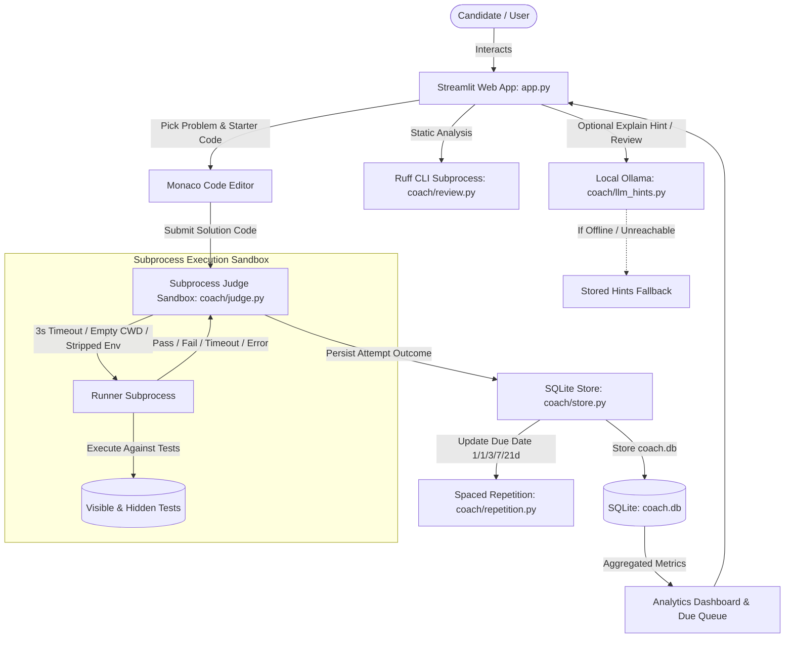

# AI Coding Prep Coach (MVP)

A zero-cost, local-first technical interview practice tool in Python and Streamlit.
**The judge is CODE, not AI.** Candidate solutions are scored strictly and objectively by executing against hidden unit tests in a subprocess sandbox. A local LLM may explain hints and review code, but it never scores solutions, never invents tests, and the platform operates fully with Ollama turned off.

---

## ⚡ Quickstart (One-Command Run)

```bash
# 1. Install dependencies
pip install -r requirements.txt

# 2. Run the Streamlit application
streamlit run app.py
```

---

## 🤖 Optional Local AI Setup (Ollama in 3 Steps)

Local AI features (progressive hint explanations and post-pass conceptual code reviews) use a local Ollama instance with `qwen2.5-coder:3b`. If Ollama is not running, the application gracefully degrades to stored problem hints.

1. **Install Ollama**: Download from [ollama.com](https://ollama.com/download) or run `winget install Ollama.Ollama`.
2. **Pull the Model**:
   ```bash
   ollama pull qwen2.5-coder:3b
   ```
3. **Start Ollama Service**: Run `ollama serve` (or launch the Ollama desktop tray application).

---

## 🏗️ Architecture Diagram



---

## 🛡️ Sandbox Security & Execution Rules

1. **Subprocess Isolation**: Every candidate submission executes in a separate Python process spawned via `subprocess.run()`.
2. **Hard Time Limit**: 3.0-second timeout per test run. Infinite loops are killed by SIGTERM/SIGKILL and reported as `TIMEOUT`.
3. **Isolated Working Directory**: Each run is restricted to an empty, temporary scratch directory created via `tempfile.TemporaryDirectory()`.
4. **Environment Sanitization**: All environment variables are stripped; API keys (`OPENAI_API_KEY`, `ANTHROPIC_API_KEY`, etc.) and user secrets are inaccessible inside user code.
5. **No Network Access**: The runner executes locally without network access.
6. **No Runtime Eval in App**: User code is never executed via `eval()` or `exec()` in the main Streamlit application process.

---

## 🚫 What This Is NOT

> **A local practice tool, not a proctored exam system.**
> This coach is designed for personal skill development, deterministic self-testing, and retention reinforcement. It does not provide proctoring, webcam monitoring, user accounts, or cloud credential verification.
